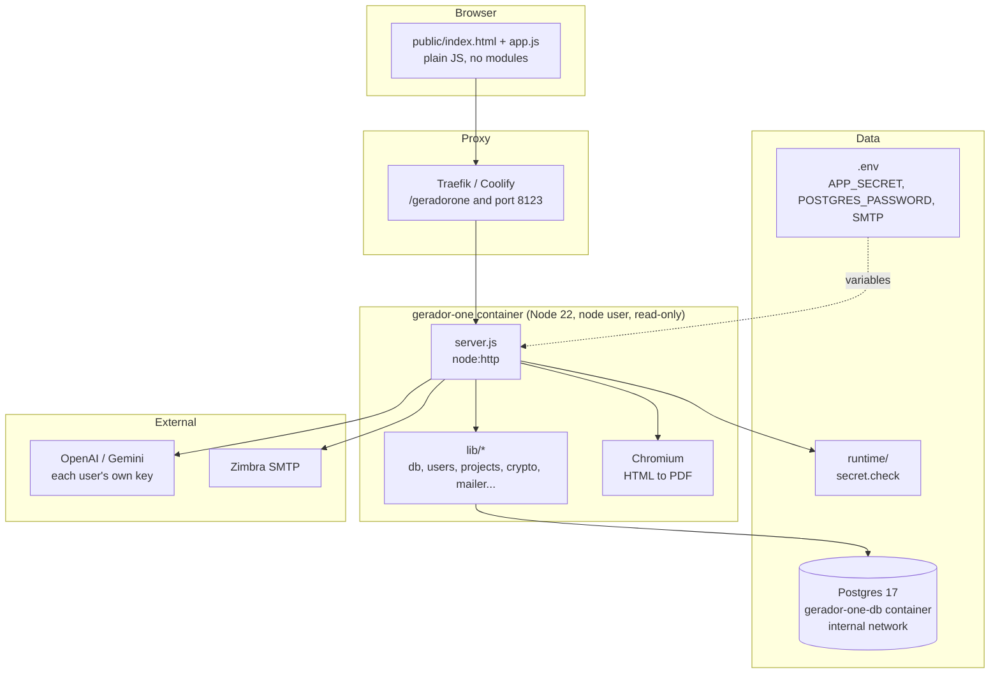
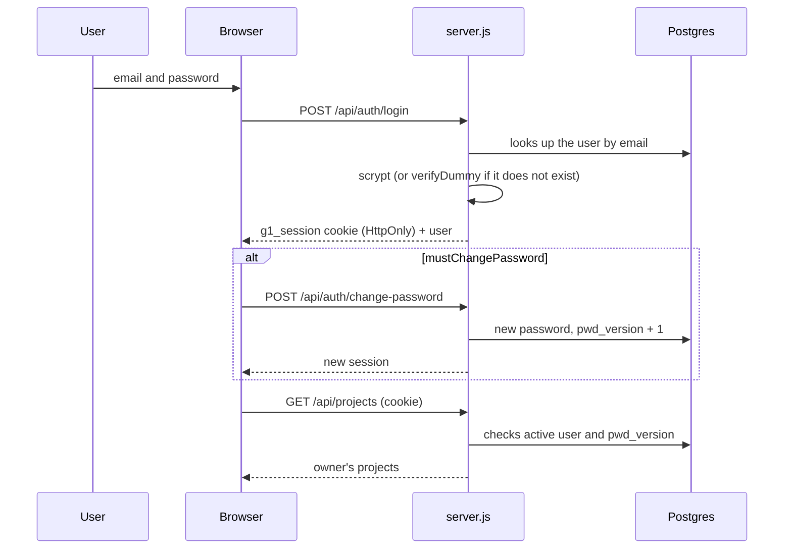
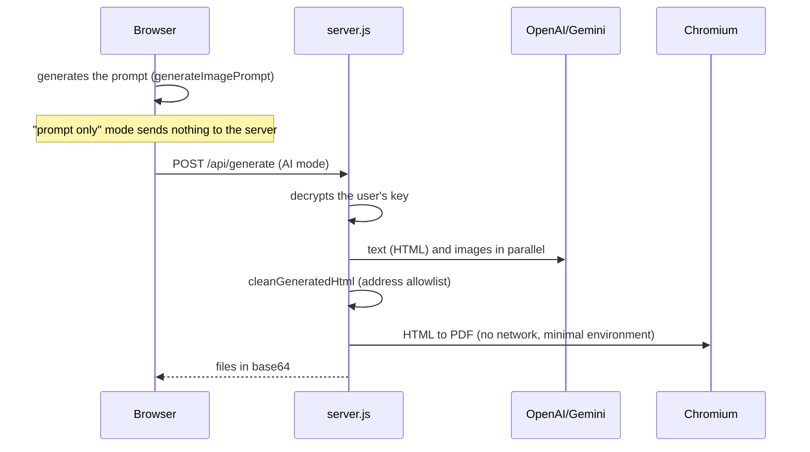

[Português](CODEBASE_MAP.md) | **English**

# GeradorOne code map

> Generated by Cartographer on 2026-10-23 (03:06 UTC) and revised by hand. The numbers count project files only: `.agents/`, `.claude/`, `.remember/` (tooling), `docs/exemplos/`, `docs/branding/` and `package-lock.json` are left out.

## Overview

Web application on Node.js 22 (no framework, no build step) that generates image prompts for teaching materials (workbooks and covers) and, optionally, calls an AI (OpenAI or Gemini) to generate the material. It has login by email and password, admin and user roles, projects saved per user, and each person's own AI key (BYOK) encrypted on the server.



## Folder structure

```text
.
├── server.js                 # HTTP server, /api routes, session, AI, PDF (~670 lines)
├── lib/
│   ├── db.js                 # pg Pool, transactions, versioned migrations with lock
│   ├── users.js              # user storage and validation (Postgres)
│   ├── projects.js           # per-owner project storage + validateProject
│   ├── legacy-import.js      # imports the old JSON files once
│   ├── crypto.js             # scrypt, AES-256-GCM, HKDF, session token, codes
│   ├── secret-check.js       # master key fingerprint (refuses to start if it changes)
│   ├── mailer.js             # nodemailer: sends the emails; setConfig swaps the SMTP without a restart and setBrand sets the footer address and contact
│   ├── visuals.js            # renders <pre class="mermaid"> and <pre class="chartjs"> from the AI-generated HTML in Chromium (vendor/), returning embedded SVG and PNG
│   ├── backup.js             # reads the backup status from MONITOR_DIR (backup-db.json, pbs.json, backup.log); read-only
│   ├── legal.js              # LEGAL_VERSION: current version of the Terms and the Policy (changing the date requires everyone to accept again)
│   ├── support.js            # message and attachment validation, ticket number and support_messages table
│   ├── email-template.js     # HTML template (tables and inline styles) and plain text of the emails; logo embedded by cid
│   └── rate-limit.js         # in-memory limiter (sliding window)
├── scripts/
│   ├── reset-password.js     # emergency temporary password (docker exec)
│   ├── test-smtp.js          # tests the SMTP (--verify only connects and authenticates)
│   ├── backup-db.sh          # compressed pg_dump, 14-day rotation
│   ├── build-bncc-data.js    # converts the bncc-dev/bncc-dados clone into public/data/bncc.json (with count checks)
│   └── run-tests.js          # starts a disposable Postgres and runs the suite
├── public/                   # static frontend served with a strict CSP
│   ├── index.html            # login screen + app (menu, pages, result panel)
│   ├── app.js                # all the browser logic (~1,330 lines)
│   ├── app.css               # shell, menu, result panel, login, new pages
│   ├── theme.css             # shared components (inherited from the old design)
│   ├── design.css            # identity: tokens for the 6 themes, fonts, finish (see docs/DESIGN.md)
│   ├── style-art.js          # SVG thumbnails of the 12 illustration styles (window.styleArt)
│   ├── fonts/                # Literata and Atkinson Hyperlegible Next (woff2, SIL OFL)
│   ├── styles.css            # minified legacy base (still needed)
│   └── assets/icons/         # PNGs of the resources, logo (mapa-mental.png) and favicon
├── test/                     # node:test against a real Postgres (see "Tests")
├── docs/
│   ├── ROADMAP.md            # path to becoming a SaaS
│   ├── CODEBASE_MAP.md       # this file
│   ├── exemplos/             # one example prompt per model (waiting for the images)
│   └── branding/             # original photo of the logo
├── Dockerfile, compose.yaml  # app + db, networks, volumes, Traefik labels
```

## Backend

### `server.js`

Single entry point. It loads the master key, creates the database pool and the stores, and only listens when run directly (`require.main === module`), which lets the tests import its functions.

| Block | What it does |
|---|---|
| `handleRequest` | Parses the URL (400 if invalid), sends `/api/*` to `handleApi` and serves files from `public/` with CSP, `nosniff` and `Referrer-Policy`. Any error becomes a 500 without taking the process down. |
| `handleApi` | Order of guards: public health check, origin check on non-GET methods, public authentication routes, session, forced password change, and then users (admin) or the app routes. |
| Session | Cookie `g1_session` (HttpOnly, SameSite=Lax, `Secure` with HTTPS, path taken from `X-Forwarded-Prefix`). Signed token `{uid, v, exp}`; `v` is the password version. |
| AI | `aiConfigFor(user)` decrypts the user's key. Text, image and "improve prompt" for OpenAI and Gemini; Anthropic (`requestAnthropicText`, `POST https://api.anthropic.com/v1/messages`, header `anthropic-version: 2026-10-21`) does text only, and `/api/generate` rejects requests with images for it. All with timeouts. |
| PDF and HTML | `renderPdf` (pdfkit, prompt only), `renderDocument` (preview), `cleanGeneratedHtml` (sanitizer), `embedImages`, `htmlToPdf` (Chromium). |

### API routes

| Method | Path | Access | Purpose |
|---|---|---|---|
| GET | `/api/health` | public | `{ok, db}`; 503 if the database does not respond |
| POST | `/api/auth/login` | public | Sign in; generic error; 429 after 8 failures in 15 min |
| POST | `/api/auth/logout` | public | Clears the cookie |
| GET | `/api/auth/config` | public | `{emailReset, signup}` (they show "Forgot password" and "Create account"; both depend on the SMTP) |
| POST | `/api/auth/forgot` | public | Stores a pending code and new password and sends the email; the response is always generic |
| POST | `/api/auth/confirm` | public | Checks the code (5 attempts, 10 min) and applies the password |
| POST | `/api/auth/signup` | public | Self-registration: validates name, email and password, keeps the request in memory and sends a 6-digit code; the response is always generic (an already registered email gets no code); 503 without SMTP |
| POST | `/api/auth/signup/confirm` | public | Checks the code (5 attempts, 10 min), creates the user with the `user` role and no forced password change, and opens the session |
| GET/PUT/DELETE | `/api/settings/smtp` | admin | Read, save (password encrypted with the BYOK key; blank keeps the current one) and remove the SMTP configuration set in the panel; takes effect immediately and has priority over `.env`; DELETE goes back to `.env` |
| GET | `/api/settings/backup` | admin | Backup status: database (daily pg_dump) and external copies (PBS), read from the status files in `MONITOR_DIR`. Read-only; without the folder it says so (dev) or flags an error (`BACKUP_ESPERADO=1`) |
| POST | `/api/settings/smtp/test` | admin | Checks the connection and sends a test email |
| GET | `/api/auth/me` | session | Current user |
| POST | `/api/auth/change-password` | session | Changes the password and issues a new session |
| POST | `/api/auth/profile` | session | Name and phone (phone required) |
| GET | `/api/auth/export` | session | Downloads a JSON file (`Content-Disposition: attachment`) with the account, the AI preferences (without the key value) and all of the user's projects; never includes the password hash |
| POST | `/api/auth/accept-terms` | session | Records the acceptance (`{accept: true}`): writes `terms_version` = `LEGAL_VERSION` and `terms_accepted_at`, without touching `pwd_version` (does not end sessions). `userView` returns `termsCurrent` and `legalVersion`; the frontend blocks the app (`terms` panel) while `termsCurrent` is false |
| POST | `/api/support` | session | "Contact support": validates type, text (5 to 2,000), email and attachments (up to 5, 5 MB each, 8 MB total, checking extension and first bytes), stores it in `support_messages`, sends it to `mailer.supportAddress()` with `replyTo` set to the person and sends the confirmation with a ticket number. Body of up to 12 MB on this route only; 5 per hour per account (429); the honeypot field `site` returns success without sending |
| POST | `/api/auth/delete-account` | session | Deletes the user's own account. Requires the current password (errors count toward the login limit); 409 if it is the only active administrator; deletes the projects in cascade, returns `removedProjects` and clears the cookie |
| POST | `/api/auth/theme` | session | Color theme of the account (`papel`, `grafite`, `lousa`, `azul-tinta`, `sepia`, `alto-contraste`; `sistema` = follow the system; empty = no choice yet, starts in Paper) |
| GET/POST | `/api/users` | admin | List and create (password and phone required) |
| PUT/DELETE | `/api/users/:id` | admin | Edit and delete; never leaves the app without an active administrator |
| POST | `/api/users/:id/reset-password` | admin | Temporary password, forced change |
| GET | `/api/ai/status` | session | Is the AI available for this user? |
| GET/POST | `/api/ai/config` | session | Provider, models and key (BYOK); never returns the key |
| POST | `/api/render` | session | HTML preview of the prompt |
| POST | `/api/pdf` | session | PDF of the prompt (pdfkit) |
| GET/POST | `/api/projects` | session | List and save (an id that belongs to someone else creates another project) |
| GET/DELETE | `/api/projects/:id` | session | Open and delete (owner only) |
| POST | `/api/improve` | session | Rewrites the prompt with the user's AI |
| POST | `/api/generate` | session | Generates HTML or PDF with optional images |

With `mustChangePassword`, only `/api/auth/me`, `change-password` and `logout` work; everything else answers 403 with `code: PASSWORD_CHANGE_REQUIRED`.

### Database (`lib/db.js`)

Migration 1 (`usuarios-e-projetos`), applied automatically at startup:

- `users`: `id uuid`, `name`, `email` (unique, lowercase), `phone`, `role` (`admin`/`user`), `active`, `password_hash`, `must_change_password`, `pwd_version`, `ai jsonb`, `theme` (empty until chosen), `created_at`, `updated_at`.
- `projects`: `id uuid`, `owner_id` (cascade when the user is deleted), `name`, `kind` (`apostila`/`capa`), `settings jsonb`, `prompt`, `created_at`, `updated_at`; index `(owner_id, updated_at DESC)`.
- `users.ai`: `{provider, keyEnc, model, imageModel}`; `keyEnc` has the format `v1.<iv>.<tag>.<text>` (AES-256-GCM, key derived by HKDF with the `byok` purpose).
- New schema changes go in as new versions in `MIGRATIONS`.

### `lib/` modules

| File | Key points |
|---|---|
| `users.js` | Normalizes email and phone (10 to 13 digits). `update` runs in a transaction with `FOR UPDATE` and adds 1 to `pwd_version` when the password, email, role or status changes (ends the sessions). `publicUser` hides the hash and the key. |
| `projects.js` | `save` uses an advisory lock per owner, updates only if the project belongs to the user, and limits each person to 500 projects. `validateProject` filters fields and sizes. |
| `crypto.js` | scrypt (N=16384, r=8, p=1) with constant-time comparison and `verifyDummy` for nonexistent emails; AES-256-GCM; `loadMasterSecret` (APP_SECRET, or `runtime/secret.key`); HKDF; HMAC token. |
| `visuals.js` | The AI writes declarative text only; `extractVisuals` replaces the blocks with markers (at most 12, code up to 20 thousand characters, charts only of the types bar, line, pie, doughnut, radar, polarArea and scatter, up to 8 series and 200 points). `drawInBrowser` opens a dedicated page in Chromium with no network, using `vendor/mermaid.min.js` and `vendor/chart.umd.min.js`, and reads the result with `--dump-dom`. The SVG goes through `cleanDiagramSvg` and the chart comes back as a base64 PNG. A failure in one item becomes a warning with the code; with no blocks at all, the browser does not even open. Called by `requestAiHtml`. |
| `secret-check.js` | Keeps a fingerprint of the master key in `runtime/secret.check`; if it changes, the server refuses to start unless `ALLOW_NEW_SECRET=true`. |
| `legacy-import.js` | Imports `runtime/users.json` and `projects.json` when the database is empty and renames the files to `*.migrado-YYYYMMDD`. |
| `mailer.js` | Transport created on demand; `enabled` only with `SMTP_HOST` and `SMTP_FROM`; `setTransport` for tests. |
| `rate-limit.js` | In-memory sliding window, per process. |

### Environment variables

| Variable | Default | Purpose |
|---|---|---|
| `DATABASE_URL` | required | Postgres connection (in the compose file, built from `POSTGRES_PASSWORD`) |
| `POSTGRES_PASSWORD` | required in the compose file | Database password |
| `APP_SECRET` | generates `runtime/secret.key` | Master key (32+ characters); encrypts the AI keys and signs the sessions |
| `ALLOW_NEW_SECRET` | empty | `true` accepts a new master key for one startup |
| `ADMIN_NAME`, `ADMIN_EMAIL`, `ADMIN_PHONE`, `ADMIN_PASSWORD` | `Administrador`, `admin@geradorone.local`, empty, random | First administrator |
| `SMTP_HOST/PORT/SECURE/REQUIRE_TLS/USER/PASS/FROM` | port 587 | Password recovery by email |
| `PORT`, `HOST`, `RUNTIME_DIR`, `CHROMIUM_PATH`, `PDF_FONT_DIR` | 3000, 127.0.0.1, `./runtime`, `/usr/bin/chromium-browser`, `/usr/share/fonts/dejavu` | Server and PDF |
| `TEST_DATABASE_URL` | set by `npm test` | Postgres for the tests |
| `BACKUP_DIR` | `./backups` | Destination of `backup-db.sh` |

### Startup

`checkMasterSecret` → `prepare()` (migrations and JSON import) → `ensureAdmin()` (creates the administrator if there are no users; prints the temporary password in the log if it was generated) → `listen`. Any error prints `[erro] ...` and exits with code 1. `SIGTERM` and `SIGINT` close the server and the database.

## Frontend

A single classic script (`app.js`), no modules. There is no `style=` or inline script because of the CSP; the JS sets CSS variables through the browser API, which is allowed.

**Login screen** (`#auth-screen`): two areas (form on the left, logo on the right), with four panels switched by `showAuth`: `login`, `forgot`, `confirm` and `first` (forced password change).

**App** (`#shell`): collapsible side menu (Ctrl+B; drawer on mobile) and one `<section class="view">` per page, plus the result panel on the right.

| Page (`data-view`) | Purpose | Calls |
|---|---|---|
| `inicio` | Header (logo, "Guide to your first steps in GeradorOne" and a dividing line), title, three steps from request to material, animated demo of the 5 Workbook items (`iniciarDemoInicio` in `public/app.js`: switches item every 4 s, pauses only on mouse hover and on the "Pause animation" button, stopped under "reduce motion"; screenshots in `public/assets/inicio/`) and a full example prompt in a scrollable box with a "Copy prompt" button (`#copiar-exemplo`); the "Start" button uses `data-go-view` | none |
| `sobre` | Logo, technology badges, introduction text and the AGPL-3.0 license; "About" item in the menu footer, below "Theme", for all roles | none |
| `apostila` | Form and prompt generation (`form#formulario`) | `/api/generate` (AI mode) |
| `capa` | Front art prompt (`form#form-capa`) | none |
| `projetos` | List, open, delete and import | `/api/projects` |
| `ia` | BYOK: provider, key and models | `/api/ai/config` |
| `conta` | Profile, password change, data export (JSON) and account deletion (current password + second click on "Confirm deletion") | `/api/auth/profile`, `change-password`, `export`, `delete-account` |
| `tema` | Theme gallery and "Follow the system" | `/api/auth/theme` |
| `apostila` (BNCC selector) | In the "Teaching setup" block: a panel with filters and search over `public/data/bncc.json` (loaded only when the panel opens or when codes are typed); "Use the selected ones" writes the codes into the `bncc` field, and `bnccTextBlock` adds the official text to the prompt | `GET /data/bncc.json` (static) |
| `suporte` | "Contact support" form (type as buttons, text, attachments by click, drag or paste, name and email) | `POST /api/support` |
| `faq` | Questions and answers (data in `public/faq-data.js`), with search, category filter and the answer opening in the row | none |
| `usuarios` | User management in a table, with search, filter and per-row editing (admin) | `/api/users*` |

The result panel only appears on the `apostila` and `capa` pages (CSS rule by `data-view`).

### Languages (pt-BR, en, es, de, it)

- Core: `public/i18n.js` (UMD: browser and server). Dictionaries with the same 1,579 keys in `public/i18n/<code>.js`; `pt-BR.js` is the source. `public/i18n-ui.js` translates the marked-up HTML (`data-i18n`, `data-i18n-attr`, `data-fora-pt` for notices shown only in other languages) and draws the flag selector (`[data-seletor-idioma]`, on the login screen and in the menu footer).
- Language choice: `?lang=` in the URL, `idioma` cookie (1 year, no personal data), account (`users.language`, `POST /api/auth/language`), `Accept-Language`, pt-BR. The server uses the same core (`lib/i18n-servidor.js`): API errors have a translated `error` and a stable `code`, emails follow the recipient's language, `language` goes in the body of `api/generate`, `api/improve`, `api/render` and `api/pdf`.
- The Terms of Use and the Privacy Policy exist only in Brazilian Portuguese (contract and payment in Brazil): in another language, the server injects the `legal.ressalva` caveat and the Terms acceptance shows the same notice. `lib/mensagens-pt.js` is the Portuguese fallback for server messages.
- The prompt texts live in the dictionaries (`prompt.*`) and are assembled by `public/prompts.js`; `test/fixtures/prompts-pt-BR.json` guarantees that pt-BR does not change. Prompts for the carousel examples in other languages: `docs/exemplos-i18n/`.
- `test/i18n.test.js` fails if any language has an extra or missing key, a different `{x}` parameter or an empty value. When you change a screen text, change all five languages.

### Prompt generators (`public/prompts.js`, called by `app.js`)

- `generateImagePrompt` ("prompt only" mode, the default): image prompt, one image per page. Uses `typeProfiles` (13 types), `typeLayouts` (layout rules per type), `typeElements`, `styleProfiles` (12 styles), `pagePlan` (page plan when there is more than one page) and `imagePageFormats`. The default number of pages is 1.
- `generateCoverPrompt`: cover, with the exact texts in quotes and the same style table.
- `generatePrompt` (AI mode): full document prompt, with sections 1 to 8, plus sections 9 to 11 added on submission.

### State and flows

- `apiFetch` wraps `fetch`: 401 opens the login; 403 with `PASSWORD_CHANGE_REQUIRED` opens the password change. All addresses are relative (`'api/...'`, no leading slash) so they work under a path prefix.
- Current project: `currentProjectId` and `currentProjectKind`. Generating again and saving updates the open project ("Save as new" is the way out). The id is cleared if the type changes.
- Signing out or switching user reloads the page, which wipes all in-memory state.

### CSS

Load order: `styles.css`, `theme.css`, `app.css`, `design.css` (last, overrides the earlier ones). The theme comes from `html[data-theme]` (`papel`, `grafite`, `lousa`, `azul-tinta`, `sepia`, `alto-contraste`; `papel` is the default) and the choice is stored on the account (`users.theme`, route `POST /api/auth/theme`), with a copy in `localStorage` (`apostila-theme`). Details in `docs/DESIGN.en.md`. Breakpoints: 1180 px (result goes below), 900 px (menu becomes a drawer), 860 px (login in a single column) and 600 px (compact action bar). `[hidden]` has a global rule with `!important`.

## Main flows





## Security

- **Passwords:** salted scrypt; a nonexistent email takes the same time; the error message is identical for both cases.
- **Sessions:** no server-side storage. The cookie carries the password version; changing the password, email, role or status invalidates all sessions. The server reloads the user on every request.
- **CSRF:** `SameSite=Lax` plus an `Origin` check on everything that is not GET.
- **BYOK:** key encrypted with AES-256-GCM; `GET /api/ai/config` returns only `••••` and the last 4 characters; the key is decrypted only in memory, at the moment of calling the provider.
- **Master key:** `APP_SECRET` in `.env`, outside the database; HKDF derives separate keys for session, BYOK and recovery; `secret.check` prevents starting with a different key.
- **AI-generated HTML:** the sanitizer uses an allowlist: in address attributes (`src`, `href`, `srcset`, `action`...) only `#anchor` and `data:image/...;base64` images pass. It removes `script`, `iframe`, `object`, `embed`, `base`, `link`, `meta http-equiv`, `on*` handlers (even with no space before them) and external `url()`. Chromium runs without name resolution (`--host-resolver-rules`) and receives only `PATH`, `HOME` and `LANG`.
- **Limits:** request body of 1 MB (counts bytes and discards the excess); 500 projects per user; 10 adjustments and 1,000 characters in "improve prompt".
- **Container:** unprivileged user, read-only filesystem, no capabilities, `no-new-privileges`; the database exists only on the `internal` network and publishes no port.

## Tests

`npm test` starts a disposable Postgres 17 in Docker, creates one database per test file and removes everything at the end (45 tests). `npm run test:node` uses your own Postgres (`TEST_DATABASE_URL`).

| File | Covers |
|---|---|
| `auth.test.js` | Complete HTTP flow: session, login, password change, users, BYOK, isolation, recovery by email, origin, malformed URLs, large body. **The tests depend on each other and the order matters**; the emergency script test changes the admin's password and must be last. |
| `auth.test.js` (terms) | Signup without `acceptTerms: true` returns 400; acceptance for an old account; a new version requires a new acceptance; export carries version and date; the `termos.html` and `privacidade.html` pages are public. |
| `store.test.js` | Storage: migration, races (duplicate email, project limit), cascade, transaction, JSON import. |
| `crypto.test.js` | Password, AES-GCM, token, limiter, master key. |
| `secret.test.js` | Key fingerprint and refusal to start (starts the server as a child process). |
| `server.test.js` | Pure functions: sanitizer, PDF, preview, validation. |

## Conventions

- Interface, documents, comments, error messages and test names in Brazilian Portuguese. Commits in the `feat:`, `fix:`, `docs:` style with a Portuguese subject.
- CommonJS with the `node:` prefix; minimal, pinned dependencies (`pg`, `nodemailer`, `pdfkit`).
- Secrets never in Git or in logs; files with secrets get permission 600.
- Every change goes in a commit and is pushed to GitHub; everything runs in Docker.
- The tests use a real database, no mocks; only the email transport is injected.

## Cautions when changing things

- **`event.currentTarget` is `null` after an `await`.** Store it in a constant before the first `await` (the code already does this in every form).
- No inline styles or scripts (CSP). API addresses always relative and with no leading slash; `AUTH_PUBLIC` compares these exact strings.
- `styles.css` looks like legacy, but it still defines `.card`, `.option`, `.resource`, `.action-bar` and `.primary`; do not delete it.
- `currentProjectId` persists between generations of the same type.
- Login limits, recovery codes, pending signups and the rate limit live in process memory: they do not hold with more than one instance.
- `hasApiKey` reflects a key that can still be decrypted; if the master key is replaced, the saved keys disappear from the interface without the data being deleted.
- The emergency script test and the `auth.test.js` tests share state.

## Navigation guide

| To... | Change |
|---|---|
| New material type | `typeProfiles` (and, if it has its own layout, `typeLayouts`) in `public/app.js`; option in `select[name=tipo]` in `public/index.html` |
| New visual style | `styles` and `styleProfiles` in `public/app.js` and the sample in `styleSamples` |
| New API route | `handleAppApi` (or `handleAuthApi`/`handleUsersApi`) in `server.js`; test in `test/auth.test.js` |
| New column or table | new version in `MIGRATIONS` (`lib/db.js`); adjust the matching store and the tests in `store.test.js` |
| New menu page | `<a class="nav-item" data-view>` and `<section class="view" data-view>` in `index.html`; add it to `VIEWS` and handle it in `showView` (`app.js`); decide whether it hides the result panel in `app.css` |
| Login or session rule | `handleAuthApi`, `authenticate`, `issueSession` in `server.js`; `lib/users.js` (`pwd_version`) |
| AI key and providers | `aiConfigFor`, `nextAiSettings`, `requestOpenAiText`, `requestGeminiText`, `requestAiImage` in `server.js` |
| Email | `lib/mailer.js` and the `SMTP_*` variables |
| Deploy, network, volumes | `compose.yaml` and `Dockerfile` |
| Backup and restore | `scripts/backup-db.sh` and the README |

## Open findings (review of 2026-10-23)

Fixed in this review: process crash on an invalid `%` in the URL, full environment passed to Chromium, blocklist-based sanitizer, large request body still being accumulated, pending-code map without cleanup, `hasApiKey` true with an unreadable key, old note in `/api/render`, `pipefail` in the backup.

Still open, in order of importance:

1. **Chromium with `--no-sandbox`** processing AI-generated content (the container has no capabilities for the sandbox).
2. **`X-Forwarded-For` is trusted** for the per-IP limit key; without a proxy that overwrites the header, it can be forged. The per-email limit still holds.
3. **The per-email login limit allows locking someone else's account** for 15 minutes with 8 wrong attempts; the same applies to password recovery.
4. **Requesting a password recovery replaces another person's pending code** (their email is enough), limited to 5 requests per window.
5. **Signing out does not invalidate the token** on the server side (it only expires or dies with a password version change); the 7-day cookie does not renew.
6. **Port 8123 published on all interfaces**, in plain HTTP (planned in Phase 1 of the roadmap).
7. **32 MB `/tmp`** in the container: large PDFs with many images may overflow it.
8. **Default models** (`gpt-6-astra`, `gemini-3.8-flash`, `gpt-image-2.5-flare`, `gemini-3-pro-image-preview`) have not been verified with the providers.
9. **`ensureAdmin` prints the temporary password in the container log** when it is generated.
10. **Interface:** no `hashchange` (the browser Back button does not navigate), user "Reset password" without confirmation, the panel's JSON keeps the fixed name `projeto-geradorone.json`, theme flash on load and dead CSS from the old screens (`.hero*`, `.result-modal`, `.topbar`, `.workflow-*`, `.live-dot`, `.mini-card`).
11. **Missing test coverage:** AI endpoints (`/api/generate`, `/api/improve` with a simulated provider), authenticated `/api/pdf` and `/api/render`, the Chromium path, HTTP headers and static files, the whole frontend, `backup-db.sh`, and there is no CI.
