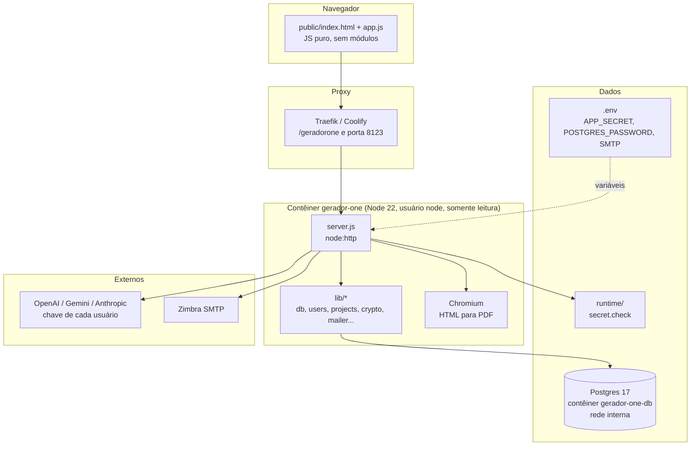
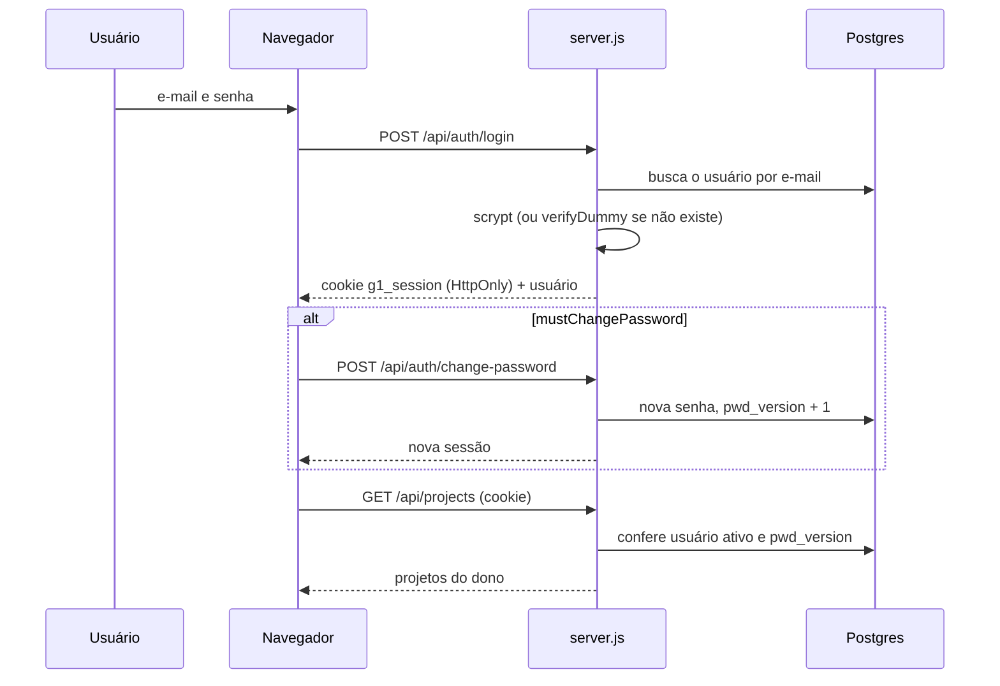
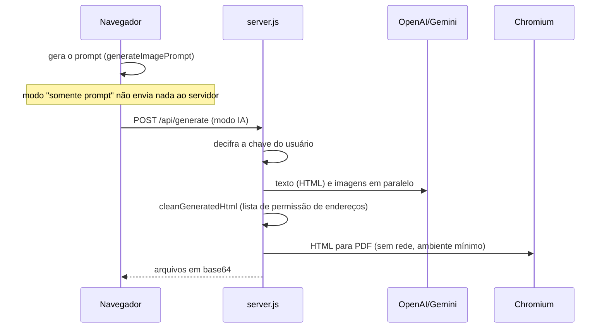
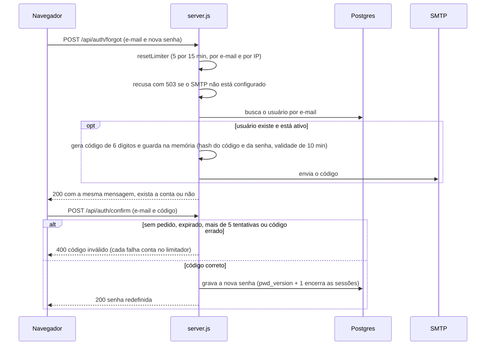
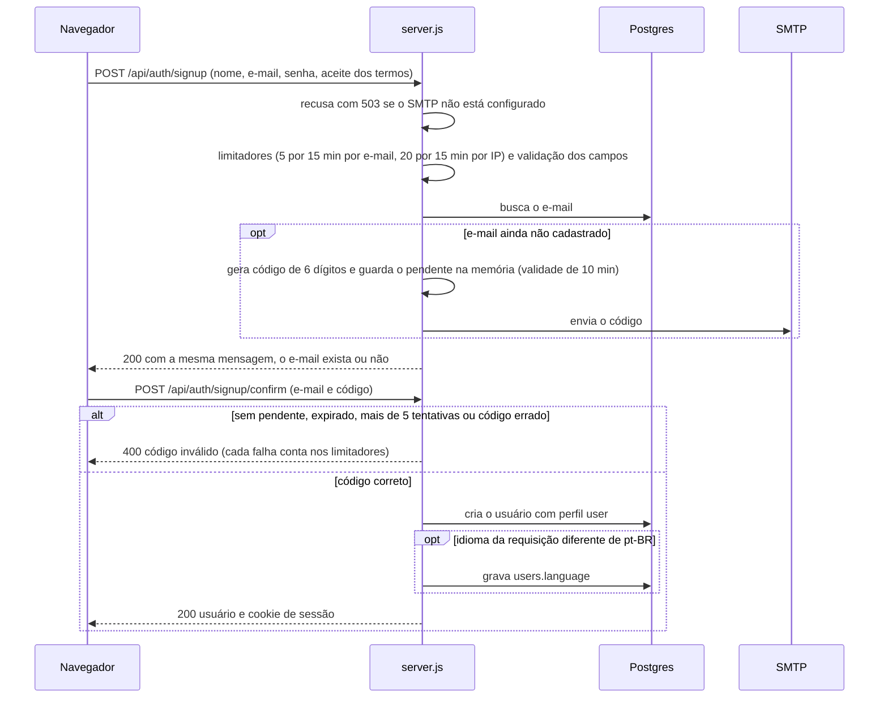
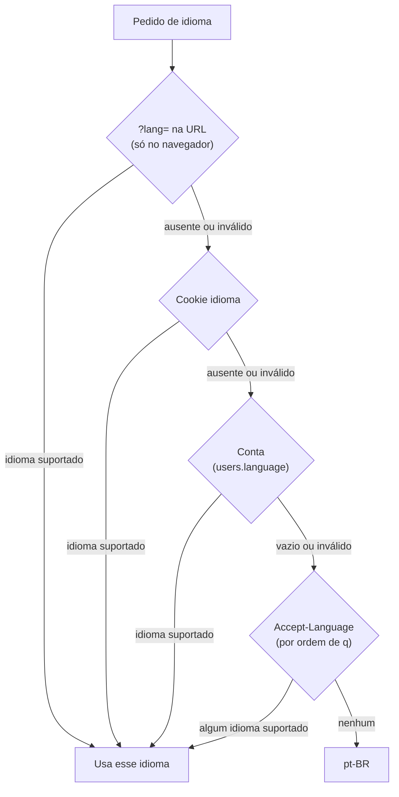
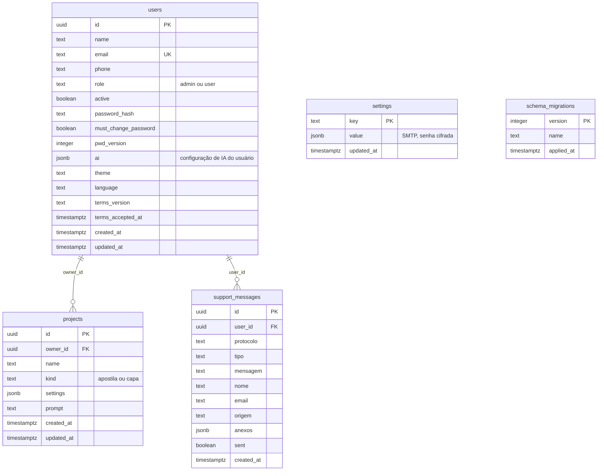

**Português** | [English](CODEBASE_MAP.en.md)

# Mapa do código do GeradorOne

> Gerado pelo Cartographer em 03/11/2026 (22:21 UTC) e revisado à mão. Os números contam só os arquivos do projeto: ficam de fora `.agents/`, `.claude/`, `.remember/` (ferramentas), `docs/exemplos/`, `docs/branding/` e o `package-lock.json`.

## Visão geral

Aplicativo web em Node.js 22 (sem framework, sem etapa de build) que gera prompts de imagem para materiais didáticos (apostilas e capas) e, opcionalmente, chama uma IA (OpenAI, Gemini ou Anthropic, esta só para texto) para gerar o material. Tem login por e-mail e senha, perfis admin e usuário, projetos salvos por usuário e a chave de IA de cada pessoa (BYOK) cifrada no servidor.



## Estrutura de pastas

```text
.
├── server.js                 # servidor HTTP, rotas /api, sessão, IA, PDF (~1.020 linhas)
├── lib/
│   ├── db.js                 # Pool do pg, transações, migrações versionadas com trava
│   ├── users.js              # armazenamento e validação de usuários (Postgres)
│   ├── projects.js           # armazenamento de projetos por dono + validateProject
│   ├── legacy-import.js      # importa os JSONs antigos uma única vez
│   ├── crypto.js             # scrypt, AES-256-GCM, HKDF, token de sessão, códigos
│   ├── secret-check.js       # impressão digital da chave mestra (recusa iniciar se mudar)
│   ├── mailer.js             # nodemailer: envio dos e-mails; setConfig troca o SMTP sem reiniciar e setBrand define endereço e contato do rodapé
│   ├── visuals.js            # desenha <pre class="mermaid"> e <pre class="chartjs"> do HTML gerado pela IA no Chromium (vendor/), devolvendo SVG e PNG embutidos
│   ├── backup.js             # lê o status do backup em MONITOR_DIR (backup-db.json, pbs.json, backup.log); só leitura
│   ├── legal.js              # LEGAL_VERSION: versão vigente dos Termos e da Política (mudar a data exige novo aceite de todos)
│   ├── support.js            # validação da mensagem e dos anexos, protocolo e tabela support_messages
│   ├── email-template.js     # modelo HTML (tabelas e estilos inline) e texto puro dos e-mails; logotipo embutido por cid
│   ├── settings.js           # configurações gerais do sistema, uma linha por chave na tabela settings (hoje: o SMTP)
│   ├── i18n-servidor.js      # idioma da requisição e mensagens do servidor (mesmos dicionários do navegador)
│   ├── mensagens-pt.js       # reserva em português das mensagens do servidor (chaves srv.*)
│   └── rate-limit.js         # limitador em memória (janela deslizante)
├── scripts/
│   ├── reset-password.js     # senha temporária de emergência (docker exec)
│   ├── test-smtp.js          # testa o SMTP (--verify só conecta e autentica)
│   ├── backup-db.sh          # pg_dump comprimido, rotação de 14 dias
│   ├── build-bncc-data.js    # converte o clone de bncc-dev/bncc-dados em public/data/bncc.json (com checagens de contagem)
│   ├── node-minimo.js        # falha o build da imagem se o Node for mais velho que o mínimo do package.json
│   └── run-tests.js          # sobe um Postgres descartável e roda a suíte
├── public/                   # frontend estático servido com CSP restrita
│   ├── index.html            # tela de login + app (menu, páginas, painel de resultado)
│   ├── app.js                # toda a lógica do navegador (~2.200 linhas)
│   ├── app.css               # shell, menu, painel de resultado, login, páginas novas
│   ├── theme.css             # componentes compartilhados (herança do desenho antigo)
│   ├── design.css            # identidade: tokens dos 6 temas, fontes, acabamento (ver docs/DESIGN.md)
│   ├── i18n.js               # núcleo de idiomas (UMD: navegador e servidor)
│   ├── i18n-ui.js            # traduz o HTML marcado e desenha o seletor de idioma com bandeiras
│   ├── i18n/                 # dicionários pt-BR, en, es, de e it (mesmas chaves)
│   ├── prompts.js            # geradores de prompt (imagem, capa e documento), com textos dos dicionários
│   ├── faq-data.js           # estrutura da FAQ (ids e categorias; os textos ficam nos dicionários)
│   ├── legal.js, legal.css   # tema e estilo das páginas públicas de Termos e Política
│   ├── termos.html, privacidade.html  # Termos de uso e Política de privacidade
│   ├── data/bncc.json        # dados da BNCC usados pelo seletor da apostila
│   ├── style-art.js          # miniaturas SVG dos 12 estilos de ilustração (window.styleArt)
│   ├── fonts/                # Literata e Atkinson Hyperlegible Next (woff2, SIL OFL)
│   ├── styles.css            # base legada minificada (ainda necessária)
│   └── assets/icons/         # PNGs dos recursos, logo (mapa-mental.png) e favicon
├── test/                     # node:test contra Postgres real (ver "Testes")
├── docs/
│   ├── ROADMAP.md            # próximos passos
│   ├── CODEBASE_MAP.md       # este arquivo
│   ├── DESIGN.md             # identidade visual e temas
│   ├── PADRAO_ICONES.md      # padrão dos botões só com ícone
│   ├── design/               # telas de referência do desenho
│   ├── exemplos/             # um prompt de exemplo por modelo (aguardando as imagens)
│   └── branding/             # foto original do logotipo
├── vendor/                   # Mermaid e Chart.js de terceiros, usados só no servidor pelo Chromium (ver vendor/README.md)
├── deploy/Caddyfile          # modelo de proxy para quem hospeda a própria instância
├── Dockerfile, compose.yaml  # app + db, redes, volumes, rótulos do Traefik
├── compose.prod.yaml         # modelo de composição para instância própria (Caddy, pasta monitor/)
```

## Backend

### `server.js`

Único ponto de entrada. Carrega a chave mestra, cria o pool do banco e os armazenamentos, e só escuta quando executado diretamente (`require.main === module`), o que permite os testes importarem as funções.

| Bloco | O que faz |
|---|---|
| `handleRequest` | Converte a URL (400 se inválida), manda `/api/*` para `handleApi` e serve arquivos de `public/` com CSP, `nosniff` e `Referrer-Policy`. Qualquer erro vira 500, sem derrubar o processo. |
| `handleApi` | Ordem de guardas: saúde pública, verificação de origem em métodos que não são GET, rotas públicas de autenticação, sessão, troca de senha obrigatória, e então usuários (admin) ou rotas do app. |
| Sessão | Cookie `g1_session` (HttpOnly, SameSite=Lax, `Secure` com HTTPS, caminho vindo de `X-Forwarded-Prefix`). Token assinado `{uid, v, exp}`; `v` é a versão da senha. |
| IA | `aiConfigFor(user)` decifra a chave do usuário. Texto, imagem e "melhorar prompt" para OpenAI e Gemini; a Anthropic (`requestAnthropicText`, `POST https://api.anthropic.com/v1/messages`, cabeçalho `anthropic-version: 2026-10-21`) só faz texto, e `/api/generate` recusa pedido com imagens para ela. Todos com tempo limite. |
| PDF e HTML | `renderPdf` (pdfkit, só do prompt), `renderDocument` (prévia), `cleanGeneratedHtml` (sanitizador), `embedImages`, `htmlToPdf` (Chromium). |

### Rotas da API

| Método | Caminho | Acesso | Função |
|---|---|---|---|
| GET | `/api/health` | público | `{ok, db}`; 503 se o banco não responde |
| POST | `/api/auth/login` | público | Entrar; erro genérico; 429 após 8 falhas em 15 min |
| POST | `/api/auth/logout` | público | Apaga o cookie |
| GET | `/api/auth/config` | público | `{emailReset, signup}` (mostram "Esqueci minha senha" e "Criar conta"; ambos dependem do SMTP) |
| POST | `/api/auth/forgot` | público | Guarda código e nova senha pendentes e envia o e-mail; resposta sempre genérica |
| POST | `/api/auth/confirm` | público | Confere o código (5 tentativas, 10 min) e aplica a senha |
| POST | `/api/auth/signup` | público | Autocadastro: valida nome, e-mail e senha, guarda o pedido na memória e envia código de 6 dígitos; resposta sempre genérica (e-mail já cadastrado não recebe código); 503 sem SMTP |
| POST | `/api/auth/signup/confirm` | público | Confere o código (5 tentativas, 10 min), cria o usuário com perfil `user` sem troca obrigatória de senha e abre a sessão |
| GET/PUT/DELETE | `/api/settings/smtp` | admin | Ler, salvar (senha cifrada com a chave BYOK; em branco mantém a atual) e remover a configuração de SMTP do painel; vale na hora e tem prioridade sobre o `.env`; DELETE volta ao `.env` |
| GET | `/api/settings/backup` | admin | Situação do backup: banco (pg_dump diário) e cópias externas (PBS), lidas dos arquivos de status em `MONITOR_DIR`. Só leitura; sem pasta, informa (dev) ou sinaliza erro (`BACKUP_ESPERADO=1`) |
| POST | `/api/settings/smtp/test` | admin | Verifica a conexão e envia e-mail de teste |
| GET | `/api/auth/me` | sessão | Usuário atual |
| POST | `/api/auth/change-password` | sessão | Troca a senha e emite sessão nova |
| POST | `/api/auth/profile` | sessão | Nome e telefone (telefone obrigatório) |
| GET | `/api/auth/export` | sessão | Baixa um JSON (`Content-Disposition: attachment`) com a conta, as preferências de IA (sem o valor da chave) e todos os projetos do usuário; nunca inclui hash de senha |
| POST | `/api/auth/accept-terms` | sessão | Registra o aceite (`{accept: true}`): grava `terms_version` = `LEGAL_VERSION` e `terms_accepted_at`, sem mexer em `pwd_version` (não derruba sessões). `userView` devolve `termsCurrent` e `legalVersion`; o frontend bloqueia o app (painel `terms`) enquanto `termsCurrent` for falso |
| POST | `/api/support` | sessão | "Fale com o suporte": valida tipo, texto (5 a 2.000), e-mail e anexos (até 5, 5 MB cada, 8 MB no total, conferindo extensão e primeiros bytes), guarda em `support_messages`, envia ao `mailer.supportAddress()` com `replyTo` na pessoa e manda a confirmação com protocolo. Corpo de até 12 MB só nesta rota; 5 por hora por conta (429); campo isca `site` devolve sucesso sem enviar |
| POST | `/api/auth/delete-account` | sessão | Exclui a própria conta. Exige a senha atual (erros contam no limite de login); 409 se for o único administrador ativo; apaga os projetos em cascata, devolve `removedProjects` e limpa o cookie |
| POST | `/api/auth/language` | sessão | Idioma da conta (`pt-BR`, `en`, `es`, `de`, `it`; vazio = sem escolha); não derruba as sessões |
| POST | `/api/auth/theme` | sessão | Tema de cores da conta (`papel`, `grafite`, `lousa`, `azul-tinta`, `sepia`, `alto-contraste`; `sistema` = seguir o sistema; vazio = ainda sem escolha, entra no Papel) |
| GET/POST | `/api/users` | admin | Listar e criar (senha e telefone obrigatórios) |
| PUT/DELETE | `/api/users/:id` | admin | Editar e excluir; nunca deixa sem administrador ativo |
| POST | `/api/users/:id/reset-password` | admin | Senha temporária, troca obrigatória |
| GET | `/api/ai/status` | sessão | A IA está disponível para este usuário? |
| GET/POST | `/api/ai/config` | sessão | Provedor, modelos e chave (BYOK); nunca devolve a chave |
| POST | `/api/render` | sessão | Prévia HTML do prompt |
| POST | `/api/pdf` | sessão | PDF do prompt (pdfkit) |
| GET/POST | `/api/projects` | sessão | Listar e salvar (id alheio cria outro projeto) |
| GET/DELETE | `/api/projects/:id` | sessão | Abrir e excluir (só do dono) |
| POST | `/api/improve` | sessão | Reescreve o prompt com a IA do usuário |
| POST | `/api/generate` | sessão | Gera HTML ou PDF com imagens opcionais |

Com `mustChangePassword`, só `/api/auth/me`, `change-password` e `logout` funcionam; o resto responde 403 com `code: PASSWORD_CHANGE_REQUIRED`.

### Banco de dados (`lib/db.js`)

Migração 1 (`usuarios-e-projetos`), aplicada sozinha na inicialização:

- `users`: `id uuid`, `name`, `email` (único, minúsculo), `phone`, `role` (`admin`/`user`), `active`, `password_hash`, `must_change_password`, `pwd_version`, `ai jsonb`, `theme` (vazio até escolher), `created_at`, `updated_at`.
- `projects`: `id uuid`, `owner_id` (cascata ao excluir o usuário), `name`, `kind` (`apostila`/`capa`), `settings jsonb`, `prompt`, `created_at`, `updated_at`; índice `(owner_id, updated_at DESC)`.
- `users.ai`: `{provider, keyEnc, model, imageModel}`; `keyEnc` tem o formato `v1.<iv>.<tag>.<texto>` (AES-256-GCM, chave derivada por HKDF com o propósito `byok`).
- Migrações seguintes: 2 `tema-do-usuario` (`users.theme`), 3 `configuracoes-do-sistema` (tabela `settings`), 4 `mensagens-ao-suporte` (tabela `support_messages`), 5 `aceite-dos-termos` (`terms_version`, `terms_accepted_at`), 6 `tema-sistema` (aceita o tema `sistema`) e 7 `idioma-do-usuario` (`users.language`).
- Novas mudanças de esquema entram como novas versões em `MIGRATIONS`.

### Módulos de `lib/`

| Arquivo | Pontos principais |
|---|---|
| `users.js` | Normaliza e-mail e telefone (10 a 13 dígitos). `update` roda em transação com `FOR UPDATE` e soma 1 em `pwd_version` quando muda senha, e-mail, perfil ou situação (derruba as sessões). `publicUser` esconde o hash e a chave. |
| `projects.js` | `save` usa trava consultiva por dono, atualiza só se o projeto for do usuário, e limita 500 projetos por pessoa. `validateProject` filtra campos e tamanhos. |
| `crypto.js` | scrypt (N=16384, r=8, p=1) com comparação em tempo constante e `verifyDummy` para e-mails inexistentes; AES-256-GCM; `loadMasterSecret` (APP_SECRET, ou `runtime/secret.key`); HKDF; token HMAC. |
| `visuals.js` | A IA escreve só texto declarativo; `extractVisuals` troca os blocos por marcadores (máximo 12, código até 20 mil caracteres, gráfico só dos tipos bar, line, pie, doughnut, radar, polarArea e scatter, até 8 séries e 200 pontos). `drawInBrowser` abre uma página própria no Chromium sem rede com `vendor/mermaid.min.js` e `vendor/chart.umd.min.js` e lê o resultado com `--dump-dom`. O SVG passa por `cleanDiagramSvg` e o gráfico volta como PNG base64. Falha em um item vira aviso com o código; sem nenhum bloco, o navegador nem abre. Chamado por `requestAiHtml`. |
| `secret-check.js` | Guarda uma impressão digital da chave mestra em `runtime/secret.check`; se ela mudar, o servidor recusa iniciar, a menos que `ALLOW_NEW_SECRET=true`. |
| `legacy-import.js` | Importa `runtime/users.json` e `projects.json` quando o banco está vazio e renomeia os arquivos para `*.migrado-AAAAMMDD`. |
| `mailer.js` | Transporte criado sob demanda; `enabled` só com `SMTP_HOST` e `SMTP_FROM`; `setTransport` para testes. |
| `settings.js` | `get`, `set` e `remove` por chave na tabela `settings` (valor em jsonb); o servidor guarda aqui o SMTP do painel. |
| `i18n-servidor.js` | Escolhe o idioma da requisição (cookie, conta, `Accept-Language`, pt-BR), traduz as chaves `srv.*` com os dicionários de `public/i18n/` e monta erros com `code` estável. |
| `mensagens-pt.js` | Mensagens do servidor em português; valem quando o dicionário ainda não tem a chave. |
| `rate-limit.js` | Janela deslizante em memória, por processo. |

### Variáveis de ambiente

| Variável | Padrão | Função |
|---|---|---|
| `DATABASE_URL` | obrigatória | Conexão com o Postgres (no compose, montada com `POSTGRES_PASSWORD`) |
| `POSTGRES_PASSWORD` | obrigatória no compose | Senha do banco |
| `APP_SECRET` | gera `runtime/secret.key` | Chave mestra (32+ caracteres); cifra as chaves de IA e assina as sessões |
| `ALLOW_NEW_SECRET` | vazio | `true` aceita uma chave mestra nova por uma inicialização |
| `ADMIN_NAME`, `ADMIN_EMAIL`, `ADMIN_PHONE`, `ADMIN_PASSWORD` | `Administrador`, `admin@geradorone.local`, vazio, aleatória | Primeiro administrador |
| `SMTP_HOST/PORT/SECURE/REQUIRE_TLS/USER/PASS/FROM` | porta 587 | Recuperação de senha por e-mail |
| `PORT`, `HOST`, `RUNTIME_DIR`, `CHROMIUM_PATH`, `PDF_FONT_DIR` | 3000, 127.0.0.1, `./runtime`, `/usr/bin/chromium-browser`, `/usr/share/fonts/dejavu` | Servidor e PDF |
| `APP_URL`, `CONTACT_EMAIL` | vazio | Endereço público do app e e-mail de contato no rodapé dos e-mails, nos Termos, na Política e na FAQ; o que o administrador salva no painel tem prioridade |
| `MONITOR_DIR` | `./monitor` | Pasta (somente leitura) com `backup-db.json`, `pbs.json` e `backup.log`, lida por `lib/backup.js` |
| `BACKUP_ESPERADO` | vazio | `1` faz a ausência da pasta de status contar como erro em `/api/settings/backup` |
| `TEST_DATABASE_URL` | definida por `npm test` | Postgres dos testes |
| `BACKUP_DIR` | `./backups` | Destino do `backup-db.sh` |

### Inicialização

`checkMasterSecret` → `prepare()` (migrações e importação dos JSONs) → `ensureAdmin()` (cria o administrador se não há usuários; imprime a senha temporária no log se ela foi gerada) → `listen`. Qualquer erro imprime `[erro] ...` e sai com código 1. `SIGTERM` e `SIGINT` fecham o servidor e o banco.

## Frontend

Um único script clássico (`app.js`), sem módulos. Não há `style=` nem scripts inline por causa da CSP; o JS ajusta variáveis CSS pela API do navegador, o que é permitido.

**Tela de login** (`#auth-screen`): duas áreas (formulário à esquerda, logo à direita), com painéis alternados por `showAuth`: `login`, `signup` e `signup-confirm` (autocadastro), `terms` (aceite dos Termos), `forgot`, `confirm` e `first` (troca obrigatória de senha).

**App** (`#shell`): menu lateral recolhível (Ctrl+B; gaveta no celular) e uma `<section class="view">` por página, mais o painel de resultado à direita.

| Página (`data-view`) | Função | Chamadas |
|---|---|---|
| `inicio` | Cabeçalho (logo, "Guia dos primeiros passos no GeradorOne" e linha), título, três passos do pedido ao material, demonstração animada dos 5 itens da Apostila (`iniciarDemoInicio` em `public/app.js`: troca de item a cada 4 s, pausa só com o mouse em cima e no botão "Pausar animação", parada com "reduzir movimento"; capturas em `public/assets/inicio/`) e prompt de exemplo completo em caixa com barra de rolagem e botão "Copiar prompt" (`#copiar-exemplo`); o botão "Iniciar" usa `data-go-view` | nenhuma |
| `sobre` | Logo, selos de tecnologia, texto de apresentação e licença AGPL-3.0; item "Sobre" no rodapé do menu, abaixo de "Tema", para todos os perfis | nenhuma |
| `apostila` | Formulário e geração do prompt (`form#formulario`) | `/api/generate` (modo IA) |
| `capa` | Prompt da arte frontal (`form#form-capa`) | nenhuma |
| `projetos` | Listar, abrir, excluir e importar | `/api/projects` |
| `ia` | BYOK: provedor, chave e modelos | `/api/ai/config` |
| `conta` | Perfil, troca de senha, exportação dos dados (JSON) e exclusão da conta (senha atual + segundo clique em "Confirmar exclusão") | `/api/auth/profile`, `change-password`, `export`, `delete-account` |
| `tema` | Galeria de temas e "Seguir o sistema" | `/api/auth/theme` |
| `apostila` (seletor da BNCC) | No bloco "Configuração pedagógica": painel com filtros e busca sobre `public/data/bncc.json` (carregado só ao abrir o painel ou ao digitar códigos); "Usar as selecionadas" grava os códigos no campo `bncc`, e `bnccTextBlock` junta o texto oficial ao prompt | `GET /data/bncc.json` (estático) |
| `suporte` | Formulário "Fale com o suporte" (tipo em botões, texto, anexos por clique, arrastar ou colar, nome e e-mail) | `POST /api/support` |
| `faq` | Perguntas e respostas (dados em `public/faq-data.js`), com busca, filtro por categoria e resposta aberta na linha | nenhuma |
| `config` | "Configurações" no menu, só para admin, em três abas: "Usuários" (tabela com busca, filtro e edição por linha), "E-mail (SMTP)" e "Backup" | `/api/users*`, `/api/settings/smtp*`, `/api/settings/backup` |

O painel de resultado só aparece nas páginas `apostila` e `capa` (regra de CSS por `data-view`).

### Idiomas (pt-BR, en, es, de, it)

- Núcleo: `public/i18n.js` (UMD: navegador e servidor). Dicionários com as mesmas 1.579 chaves em `public/i18n/<código>.js`; `pt-BR.js` é a fonte. `public/i18n-ui.js` traduz o HTML marcado (`data-i18n`, `data-i18n-attr`, `data-fora-pt` para avisos só de outros idiomas) e desenha o seletor com bandeiras (`[data-seletor-idioma]`, na tela de entrada e no rodapé do menu).
- Escolha do idioma: `?lang=` na URL, cookie `idioma` (1 ano, sem dado pessoal), conta (`users.language`, `POST /api/auth/language`), `Accept-Language`, pt-BR. O servidor usa o mesmo núcleo (`lib/i18n-servidor.js`): erros da API têm `error` traduzido e `code` estável, e-mails seguem o idioma do destinatário, `language` vai no corpo de `api/generate`, `api/improve`, `api/render` e `api/pdf`.
- Termos de uso e Política de privacidade ficam só em português do Brasil (o texto jurídico vale no Brasil): em outro idioma, o servidor injeta a ressalva `legal.ressalva` e o aceite dos Termos mostra o mesmo aviso. `lib/mensagens-pt.js` é a reserva em português das mensagens do servidor.
- Os textos do prompt moram nos dicionários (`prompt.*`) e são montados por `public/prompts.js`; `test/fixtures/prompts-pt-BR.json` garante que o pt-BR não mude. Prompts dos exemplos do carrossel em outros idiomas: `docs/exemplos-i18n/`.
- `test/i18n.test.js` falha se algum idioma tiver chave a mais ou a menos, parâmetro `{x}` diferente ou valor vazio. Ao mudar um texto de tela, mude as cinco línguas.

### Geradores de prompt (`public/prompts.js`, chamados por `app.js`)

- `generateImagePrompt` (modo "somente prompt", o padrão): prompt de imagem, uma imagem por página. Usa `perfilTipo` (13 tipos), `layoutsTipo` (regras de layout por tipo), `perfilEstilo` (12 estilos), `pagePlan` (plano de páginas quando há mais de uma) e `formatoPagina`; os textos vêm de `prompt.tipo.*`, `prompt.layout.*` e `prompt.estilo.*` nos dicionários. O número de páginas padrão é 1.
- `generateCoverPrompt`: capa, com os textos exatos entre aspas e a mesma tabela de estilos.
- `generatePrompt` (modo IA): prompt de documento completo, com as seções 1 a 8, mais as seções 9 a 11 acrescentadas no envio.

### Estado e fluxos

- `apiFetch` envolve `fetch`: 401 abre o login; 403 com `PASSWORD_CHANGE_REQUIRED` abre a troca de senha. Todos os endereços são relativos (`'api/...'`, sem barra inicial) para funcionar sob um prefixo de caminho.
- Projeto atual: `currentProjectId` e `currentProjectKind`. Gerar de novo e salvar atualiza o projeto aberto ("Salvar como novo" é a saída). O id é zerado se o tipo mudar.
- Sair ou trocar de usuário recarrega a página, o que apaga todo o estado em memória.

### CSS

Ordem de carga: `styles.css`, `theme.css`, `app.css`, `design.css` (por último, vence as anteriores). O tema vem de `html[data-theme]` (`papel`, `grafite`, `lousa`, `azul-tinta`, `sepia`, `alto-contraste`; `papel` é o padrão) e a escolha fica na conta (`users.theme`, rota `POST /api/auth/theme`), com cópia em `localStorage` (`apostila-theme`). Detalhes em `docs/DESIGN.md`. Pontos de quebra: 1180 px (resultado vai para baixo), 900 px (menu vira gaveta), 860 px (login em coluna única) e 600 px (barra de ação compacta). `[hidden]` tem regra global com `!important`.

## Fluxos principais

### Login e sessão

Do formulário de entrada até a primeira chamada autenticada.



### Geração com IA

Do prompt montado no navegador até os arquivos devolvidos.



### Recuperação de senha

A nova senha é enviada junto com o pedido e só vale depois que o código do e-mail é confirmado.



### Cadastro próprio

A conta só é criada depois da confirmação do código enviado por e-mail.



### Escolha do idioma

O núcleo `public/i18n.js` aplica a mesma precedência no navegador e no servidor. No servidor não há `?lang=`: ele parte do cookie. Depois do login, no navegador, o idioma da conta vence o cookie quando a URL não tem `?lang=`.



### Modelo de dados

Tabelas criadas pelas migrações de `lib/db.js`. A única relação com chave estrangeira é a de `users` com `projects` e `support_messages` (exclusão em cascata); `settings` e `schema_migrations` não se ligam a nenhuma tabela.



## Segurança

- **Senhas:** scrypt com salt; e-mail inexistente gasta o mesmo tempo; mensagem de erro igual para os dois casos.
- **Sessões:** sem armazenamento no servidor. O cookie carrega a versão da senha; mudar senha, e-mail, perfil ou situação invalida todas as sessões. O servidor recarrega o usuário a cada requisição.
- **CSRF:** `SameSite=Lax` mais verificação de `Origin` em tudo que não é GET.
- **BYOK:** chave cifrada com AES-256-GCM; `GET /api/ai/config` devolve só `••••` e os 4 últimos caracteres; a chave só é decifrada em memória, na hora de chamar o provedor.
- **Chave mestra:** `APP_SECRET` no `.env`, fora do banco; HKDF deriva chaves separadas para sessão, BYOK e recuperação; `secret.check` impede iniciar com uma chave diferente.
- **HTML gerado pela IA:** o sanitizador usa lista de permissão: em atributos de endereço (`src`, `href`, `srcset`, `action`...) só passam `#âncora` e imagens `data:image/...;base64`. Remove `script`, `iframe`, `object`, `embed`, `base`, `link`, `meta http-equiv`, manipuladores `on*` (mesmo sem espaço antes) e `url()` externos. O Chromium roda sem resolução de nomes (`--host-resolver-rules`) e só recebe `PATH`, `HOME` e `LANG`.
- **Limites:** corpo da requisição de 1 MB (conta bytes e descarta o excedente); 500 projetos por usuário; 10 ajustes e 1.000 caracteres no "melhorar prompt".
- **Contêiner:** usuário sem privilégios, sistema de arquivos somente leitura, sem capabilities, `no-new-privileges`; o banco só existe na rede `internal` e não publica porta.

## Testes

`npm test` sobe um Postgres 17 descartável em Docker, cria um banco por arquivo de teste e remove tudo no fim (139 testes em 18 arquivos). `npm run test:node` usa um Postgres seu (`TEST_DATABASE_URL`).

| Arquivo | Cobre |
|---|---|
| `auth.test.js` | Fluxo HTTP completo: sessão, login, troca de senha, usuários, BYOK, isolamento, recuperação por e-mail, origem, URLs malformadas, corpo grande. **Os testes dependem uns dos outros e a ordem importa**; o do script de emergência troca a senha do admin e precisa ser o último. |
| `auth.test.js` (termos) | Cadastro sem `acceptTerms: true` dá 400; aceite de conta antiga, nova versão exige novo aceite, exportação traz versão e data, e as páginas `termos.html` e `privacidade.html` são públicas. |
| `store.test.js` | Armazenamento: migração, corridas (e-mail duplicado, limite de projetos), cascata, transação, importação dos JSONs. |
| `crypto.test.js` | Senha, AES-GCM, token, limitador, chave mestra. |
| `secret.test.js` | Impressão digital da chave e recusa de iniciar (sobe o servidor como processo filho). |
| `server.test.js` | Funções puras: sanitizador, PDF, prévia, validação. |
| `backup.test.js` | `lib/backup.js`: sem a pasta de status e com os arquivos do banco e das cópias externas (atraso e falha). |
| `bncc.test.js` | Dados da BNCC: fonte e licença, contagens, registros conhecidos e reconhecimento de códigos digitados. |
| `faq.test.js` | FAQ: campos preenchidos, ids únicos, links https, sem travessão e as mesmas chaves nos cinco idiomas. |
| `faq-badges.test.js` | Categorias da FAQ como badges que filtram, só com tokens do tema. |
| `i18n.test.js` | Núcleo de idiomas: precedência da escolha, normalização, plural e dicionários com as mesmas chaves e parâmetros. |
| `i18n-servidor.test.js` | Idioma no servidor: precedência, erros com `code` estável, e-mails, prévia, PDF e páginas legais com a ressalva. |
| `mailer.test.js` | Modelo dos e-mails: cabeçalho, código, rodapé com endereço e contato, e escape de HTML. |
| `node-minimo.test.js` | Versão mínima do Node: comparação por parte numérica, `engines.node` e checagem no `Dockerfile`. |
| `olho-senha.test.js` | Botão de mostrar a senha em todos os campos de senha. |
| `prompts.test.js` | Geradores de prompt: pt-BR idêntico ao original (`test/fixtures/prompts-pt-BR.json`) e textos dos outros idiomas. |
| `prompt-revisao.test.js` | Bloco de revisão técnica nos prompts de imagem e de capa, na geração e nos exemplos. |
| `support.test.js` | Mensagem de suporte: validação, anexos, nome do arquivo, campo isca e protocolo. |
| `visuals.test.js` | Diagramas e gráficos do HTML da IA: extração, limites, limpeza do SVG e desenho no Chromium. |

## Convenções

- Interface, documentos, comentários, mensagens de erro e nomes de teste em português do Brasil. Commits no estilo `feat:`, `fix:`, `docs:` com assunto em português.
- CommonJS com prefixo `node:`; dependências mínimas e fixadas (`pg`, `nodemailer`, `pdfkit`).
- Segredos nunca no Git nem em logs; arquivos com segredo ficam com permissão 600.
- Cada mudança vai em commit e é enviada ao GitHub; tudo roda em Docker.
- Os testes usam banco real, sem simulação; só o transporte de e-mail é injetado.

## Cuidados ao mexer

- **`event.currentTarget` é `null` depois de um `await`.** Guarde em uma constante antes do primeiro `await` (o código já faz isso em todos os formulários).
- Sem estilos nem scripts inline (CSP). Endereços da API sempre relativos e sem barra inicial; `AUTH_PUBLIC` compara essas strings exatas.
- `styles.css` parece legado, mas ainda define `.card`, `.option`, `.resource`, `.action-bar` e `.primary`; não apague.
- `currentProjectId` persiste entre gerações do mesmo tipo.
- Os limites de login, os códigos de recuperação, os cadastros pendentes e o rate limit ficam na memória do processo: não valem com mais de uma instância.
- `hasApiKey` reflete uma chave que ainda pode ser decifrada; se a chave mestra for trocada, as chaves salvas somem da interface sem apagar o dado.
- O teste do script de emergência e os testes de `auth.test.js` compartilham estado.

## Guia de navegação

| Para... | Mexa em |
|---|---|
| Novo tipo de material | textos `prompt.tipo.<tipo>.*` (e `prompt.layout.<tipo>_N`, se tiver layout próprio) nos cinco dicionários de `public/i18n/`; lógica em `perfilTipo` e `layoutsTipo` (`public/prompts.js`); opção `input[name=tipo]` em `public/index.html` |
| Novo estilo visual | lista `styles` em `public/app.js`, textos `prompt.estilo.<estilo>.*` e `js.estilo.<estilo>.*` nos dicionários, `perfilEstilo` em `public/prompts.js` e a miniatura em `public/style-art.js` |
| Nova rota da API | `handleAppApi` (ou `handleAuthApi`/`handleUsersApi`) em `server.js`; teste em `test/auth.test.js` |
| Nova coluna ou tabela | nova versão em `MIGRATIONS` (`lib/db.js`); ajuste a store correspondente e os testes de `store.test.js` |
| Nova página no menu | `<a class="nav-item" data-view>` e `<section class="view" data-view>` em `index.html`; incluir em `VIEWS` e tratar em `showView` (`app.js`); decidir se esconde o painel de resultado em `app.css` |
| Regra de login ou sessão | `handleAuthApi`, `authenticate`, `issueSession` em `server.js`; `lib/users.js` (`pwd_version`) |
| Chave de IA e provedores | `aiConfigFor`, `nextAiSettings`, `requestOpenAiText`, `requestGeminiText`, `requestAnthropicText`, `requestAiImage` em `server.js` |
| E-mail | `lib/mailer.js` e as variáveis `SMTP_*` |
| Deploy, rede, volumes | `compose.yaml` e `Dockerfile` |
| Backup e restauração | `scripts/backup-db.sh` e o README |

## Achados em aberto (revisão de 23/10/2026)

Corrigidos nesta revisão: queda do processo com `%` inválido na URL, ambiente completo repassado ao Chromium, sanitizador por lista de bloqueio, corpo de requisição grande continuar sendo acumulado, mapa de códigos pendentes sem limpeza, `hasApiKey` verdadeiro com chave ilegível, nota antiga em `/api/render`, `pipefail` no backup.

Ainda abertos, por ordem de importância:

1. **Chromium com `--no-sandbox`** processando conteúdo gerado por IA (o contêiner não tem capabilities para o sandbox).
2. **`X-Forwarded-For` é confiado** para a chave de limite por IP; sem proxy que sobrescreva o cabeçalho, ele pode ser forjado. O limite por e-mail continua valendo.
3. **O limite de login por e-mail permite travar uma conta de terceiros** por 15 minutos com 8 tentativas erradas; o mesmo vale para a recuperação de senha.
4. **Pedir recuperação de senha substitui um código pendente de outra pessoa** (basta o e-mail dela), limitado a 5 pedidos por janela.
5. **Sair não invalida o token** do lado do servidor (ele só expira ou cai com a troca de versão da senha); o cookie de 7 dias não renova.
6. **Porta 8123 publicada em todas as interfaces**, em HTTP puro (previsto na Fase 1 do roadmap).
7. **`/tmp` de 32 MB** no contêiner: PDFs grandes com muitas imagens podem estourar.
8. **Modelos padrão** (`gpt-6-astra`, `gemini-3.8-flash`, `gpt-image-2.5-flare`, `gemini-3-pro-image-preview`) não foram verificados nos provedores.
9. **`ensureAdmin` imprime a senha temporária no log** do contêiner quando ela é gerada.
10. **Interface:** sem `hashchange` (Voltar do navegador não navega), "Redefinir senha" de usuário sem confirmação, o JSON do painel mantém o nome fixo `projeto-geradorone.json`, piscar de tema ao carregar e CSS morto das telas antigas (`.hero*`, `.result-modal`, `.topbar`, `.workflow-*`, `.live-dot`, `.mini-card`).
11. **Cobertura de testes ausente:** endpoints de IA (`/api/generate`, `/api/improve` com provedor simulado), `/api/pdf` e `/api/render` autenticados, o caminho do Chromium, cabeçalhos HTTP e arquivos estáticos, o frontend inteiro, o `backup-db.sh`, e não há CI.
